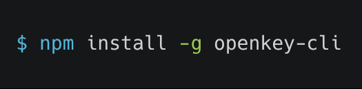

<p align="center">
   
</p>

# OpenKey CLI

OpenKey CLI is the command-line companion for the self-hosted, end-to-end encrypted [OpenKey](https://github.com/OpenSelfHosting/OpenKey) password manager.

It helps you:

- generate strong passwords entirely offline
- manage secrets, logins, cards, and crypto records from a local unlocked OpenKey app
- discover SSH keys, `.env` files, API tokens, AWS credentials, and other likely leaks on your machine
- export selected values into your shell or a child process
- sync encrypted data with a self-hosted OpenKey server when you want server-backed access

This README is a practical quick-start guide. For deeper product docs and platform setup notes, see the [CLI guide](https://openkey.openselfhosting.com/guide/cli).

## Why use OpenKey CLI?

OpenKey CLI is designed for developers who want a fast, local-first workflow without uploading secrets to a third-party service.

Typical use cases:

- generate and rotate app passwords without leaving the terminal
- keep API tokens, SSH keys, and `.env` values in a structured vault
- retrieve a secret for a single command or shell session without exposing it in your shell history
- discover secrets already sitting on disk and bring them under versioned vault control
- operate in a self-hosted setup where the server only stores encrypted payloads

## Requirements

- Node.js 20 or newer
- For local vault access without a server: an unlocked OpenKey desktop app or Android app on the same machine
- For server-backed usage: a running [OpenKey_server](https://github.com/OpenSelfHosting/OpenKey_server) instance

## Install

### From npm (recommended)

```bash
npm install -g openkey-cli
openkey --version
```

### Run without installing globally

```bash
npx openkey-cli --help
npx tsx src/cli.ts --help
node dist/cli.js --help
```

### From source

```bash
git clone https://github.com/OpenSelfHosting/OpenKey_cli.git
cd OpenKey_cli
npm install
npm run build
npm link
```

`npm link` is optional, but it makes the `openkey` binary available globally on your PATH.

## Common workflows

A good default workflow looks like this:

```bash
# 1) check whether a local bridge or server session is available
openkey status

# 2) generate a password without touching your vault
openkey gen -l 24 --no-symbols

# 3) scan for likely secrets and review the results
openkey discover --dry-run

# 4) save approved findings into a device collection
openkey discover -y

# 5) list or fetch the values you need
openkey secret list
openkey get "GitHub" --field username
openkey secret copy "GitHub PAT"

# 6) export selected values for the current shell session
eval "$(openkey env DATABASE_URL GITHUB_TOKEN)"
```

OpenKey CLI also supports a server-backed flow for self-hosted deployments:

```bash
openkey config set-server http://localhost:8000
openkey login --email you@example.com
eval "$(openkey unlock)"
openkey sync
```

## Quick start

These examples assume the OpenKey desktop app is already unlocked and running locally.

```bash
# health check
openkey status

# generate a password without needing a vault
openkey gen -l 24 --no-symbols

# preview discovered secrets without saving anything
openkey discover --dry-run

# import discovered values into a device collection
openkey discover -y

# add a secret manually
openkey secret add --name "GitHub PAT" --kind apiToken --secret ghp_...

# add a secret from stdin
printf '%s' 'ghp_...' | openkey secret add -n "GitHub PAT" --stdin

# list secrets in the vault
openkey secret list
openkey secret list -d laptop -k apiToken

# export a device-specific .env file
openkey secret export -d laptop -o .env.local

# copy a secret to the clipboard and clear it after 45s
openkey secret copy "GitHub"

# show a TOTP code and copy it
openkey totp "GitHub" -c

# fetch a field from a matching item
openkey get "GitHub" --field username

# search by name or content
openkey search api

# export env vars for the current shell
eval "$(openkey env DATABASE_URL GITHUB_TOKEN)"

# run a command with secrets injected into its environment
openkey run -e DATABASE_URL -e GH=GitHub -- npm start
```

Shell completion is available for Bash, Zsh, and Fish:

```bash
eval "$(openkey completion zsh)"
```

## Android / Termux setup

If you use the OpenKey Android app, unlock it and open the relevant terminal configuration screen, then:

```bash
pkg install nodejs
npm install -g openkey-cli
export OPENKEY_NATIVE_PORT=...
export OPENKEY_NATIVE_TOKEN=...
openkey status
```

The port and token are short-lived and are generated for the current unlocked session. Re-copy them after locking the vault again.

## Optional: self-hosted server mode

This mode uses a self-hosted OpenKey server for encrypted sync and session-based access.

```bash
openkey config set-server http://localhost:8000
openkey login --email you@example.com
eval "$(openkey unlock)"
openkey sync
eval "$(openkey lock)"
```

Notes:

- the master password is entered interactively, or provided via `OPENKEY_PASSWORD` in scripts/CI
- the email can also be supplied through `OPENKEY_EMAIL`
- the password must never be passed as a CLI flag

## Backends and access model

OpenKey CLI supports two primary backends.

1. Native bridge
   - uses an unlocked OpenKey desktop app or Android app locally
   - this is the default path for vault-backed commands
   - works for secrets, logins, cards, crypto wallets, password generation, and discovery

2. CLI session
   - obtained with `openkey login` + `openkey unlock`
   - exports `OPENKEY_SESSION` for the current shell
   - allows CLI commands to operate without the local desktop app being open

`openkey gen` works without either backend because it generates passwords locally and does not access the vault.

The config file is stored in the standard user config directory:

- macOS: `~/Library/Application Support/OpenKey/config.json`
- Linux: `~/.config/openkey/config.json`
- Windows: `%APPDATA%\OpenKey\config.json`

## Command reference

These are the commands most people use day to day.

### At a glance

- `openkey gen` — generate a strong password offline
- `openkey discover` — scan a machine for likely secrets and onboard them
- `openkey secret ...` — add, list, get, update, and export secrets
- `openkey logins`, `openkey cards`, `openkey crypto` — inspect non-secret vault records
- `openkey get`, `openkey copy`, `openkey totp` — fetch values for a single item
- `openkey env` / `openkey run` — inject values into shells or child processes
- `openkey sync`, `openkey login`, `openkey unlock` — use self-hosted server mode
- `openkey doctor` — check local bridge/session/server health

### 1) Password generation

#### `openkey gen`

Generate a password completely offline. This command does not require login, app unlock, or a server connection.

Common options:

```bash
openkey gen --help
openkey gen -l 24
openkey gen -l 32 --no-symbols
openkey gen -l 20 --no-upper --no-digits
openkey gen -l 28 -a -c
```

What it does:

- creates a secure password of the requested length
- supports uppercase, lowercase, digits, and symbols toggles
- can avoid ambiguous characters such as `I`, `l`, `1`, `O`, `0`
- can copy the result to your clipboard with `-c`

Use this when you need a new strong password for a service or for testing local credentials without touching any vault state.

### 2) Discovering secrets on-device

#### `openkey discover`

Search the current machine for likely secrets and import them into the OpenKey vault under a device collection.

Examples:

```bash
openkey discover --dry-run
openkey discover -d laptop --depth 5
openkey discover --no-ssh --no-aws -y
```

This command can scan:

- SSH keys and config
- `.env` files
- exported environment variables
- AWS config/credentials
- GitHub CLI token data
- Docker registry auth

Flags:

- `-d, --device`: choose the target device collection name
- `-p, --path`: scan specific directories
- `--depth`: max directory recursion depth for `.env` discovery
- `--dry-run`: show candidates without saving them
- `-y, --yes`: save new findings without prompting

Use this to quickly onboard secrets into a structured, device-based vault instead of manually adding each item.

### 3) Managing developer secrets

OpenKey stores secret entries in device collections and allows typed secret kinds.

#### Secret kinds

- `apiToken` (default)
- `sshKey`
- `envSnippet`
- `other`

#### `openkey secret add`

Create a new secret object.

```bash
openkey secret add --name "GitHub PAT" --kind apiToken --secret ghp_...
openkey secret add -n "SSH key" -k sshKey --file ~/.ssh/id_ed25519
openkey secret add -n "My token" --stdin --secret -
```

Useful options:

- `-n, --name`: display name
- `-k, --kind`: secret type
- `-s, --secret`: raw value
- `-f, --file`: read a value from a file
- `--stdin`: read from stdin
- `-u, --username`: related username
- `-H, --host`: hostname or service target
- `-d, --device`: assign a device collection
- `--public-key`, `--public-key-file`: SSH-related metadata
- `--notes`: description notes

#### `openkey secret set`

Create or update a secret matched by the combination of name and device.

```bash
openkey secret set -n "GitHub PAT" -k apiToken -s ghp_...
```

This is useful when you want to upsert a secret without worrying whether the item already exists.

#### `openkey secret list`

List all secrets with masked values.

```bash
openkey secret list
openkey secret list -d laptop
openkey secret list -k apiToken
```

This is safe for inspection because secret values are masked rather than printed in full.

#### `openkey secret get`

Print the raw secret value for a matched item.

```bash
openkey secret get "GitHub PAT"
```

Use this when you need the actual credential value in a script or terminal. Because it prints the plaintext secret, use it deliberately.

#### `openkey copy`

Copy a best-match vault item by name, host, or UUID prefix without requiring the `secret` subcommand. This is the shorthand for the common “copy a secret to clipboard” workflow.

```bash
openkey copy "GitHub PAT"
openkey copy "GitHub" --clear 60
```

When the item is not a secret, OpenKey copies the matched value in the same way the generic `get` command resolves it.

#### `openkey secret copy`

Copy a secret directly to the system clipboard.

```bash
openkey secret copy "GitHub PAT"
openkey secret copy "GitHub PAT" --clear 120
openkey secret copy "GitHub PAT" --keep
```

The clipboard auto-clears after 45 seconds by default unless you disable that behavior with `--keep`.

#### `openkey secret update`

Modify fields on an existing secret without recreating it.

```bash
openkey secret update "GitHub PAT" --secret ghp_newvalue
openkey secret update "GitHub PAT" --notes "Rotated on 2026-10-29"
```

#### `openkey secret export`

Export secrets in a format ready for shell use.

```bash
openkey secret export -d laptop -o .env.local
openkey secret export --format exports
```

This creates either a `.env`-style file or shell-export format, depending on the selected mode.

#### `openkey secret devices`

List device collections and the number of secrets assigned to each one.

```bash
openkey secret devices
```

#### `openkey secret rm`

Delete a secret.

```bash
openkey secret rm "GitHub PAT" -y
```

This command prompts by default unless `-y` is used.

### 4) Working with logins, cards, and crypto items

In addition to typed secrets, OpenKey CLI can query other item categories already present in the vault.

#### `openkey logins`

List login entries with masked passwords.

#### `openkey cards`

List payment cards with numbers masked.

#### `openkey crypto`

List crypto wallets with masked keys or seed material.

#### `openkey search`

Search across secrets, logins, cards, and crypto items using a keyword query.

```bash
openkey search api
openkey search github
```

#### `openkey get`

Retrieve a value from a matching item when the item is not a plain secret.

```bash
openkey get "GitHub" --field username
```

This is the general-purpose “fetch a known field from a credential item” command.

#### `openkey totp`

Generate a time-based one-time password for a matching login or secret record.

```bash
openkey totp "GitHub"
openkey totp "GitHub" -c
```

Use `-c` to copy the TOTP code to the clipboard.

### 5) Exporting values into shell commands

#### `openkey env`

Print environment-export statements for one or more vault items.

```bash
eval "$(openkey env DATABASE_URL GITHUB_TOKEN)"
openkey env DATABASE_URL
openkey env DATABASE_URL=GitHub
```

This is intended for shell workflows where you want to inject secrets into your current session.

#### `openkey run`

Run a child process with selected secret values injected into its environment.

```bash
openkey run -e DATABASE_URL -e GH=GitHub -- npm start
```

The command after `--` receives the environment variables you configured and runs normally.

### 6) Server / session commands

These commands are used for self-hosted server mode.

#### `openkey login`

Log in to the configured self-hosted server.

```bash
openkey login --email you@example.com
```

#### `openkey logout`

Clear server access tokens.

#### `openkey unlock`

Unlock the server-backed vault and print a shell-ready `OPENKEY_SESSION` export.

```bash
eval "$(openkey unlock)"
```

#### `openkey lock`

Print the command to clear the active `OPENKEY_SESSION`.

#### `openkey sync`

Pull ciphertext from the server and optionally push the local cache.

```bash
openkey sync
openkey sync --push
```

#### `openkey config set-server`

Set the OpenKey server URL.

```bash
openkey config set-server http://localhost:8000
```

#### `openkey config show`

Display the current CLI configuration.

#### `openkey config set-lock`

Set the unlock session lifetime in minutes.

### 7) Diagnostics and utilities

#### `openkey status`

Show the current status of the local bridge, running session, and server connection.

#### `openkey doctor`

Run a focused diagnosis of CLI, bridge, session, and server health.

```bash
openkey doctor
```

#### `openkey completion`

Print a shell completion script.

```bash
openkey completion bash
openkey completion zsh
openkey completion fish
```

#### `openkey forget`

Wipe local config and cached ciphertext from the CLI.

## Global behavior

- `--json` makes output machine-readable
- clipboard copies are cleared automatically after 45 seconds by default
- use `--keep` if you want the copied value to remain in the clipboard
- `--clear N` changes the clipboard timeout in seconds

## Security notes

- `list` and `search` mask secret values; use `get` or `copy` when you need the plaintext
- never pass the master password as a CLI flag
- session lifetimes default to a limited window and can be set with `openkey config set-lock`
- bridge access is local-only while the vault remains unlocked
- server mode stores ciphertext; the real key material remains client-side

## Development

```bash
npm test
npm run typecheck
npm run build
```

## License

OpenKey CLI is licensed under the [MIT License](./LICENSE).
